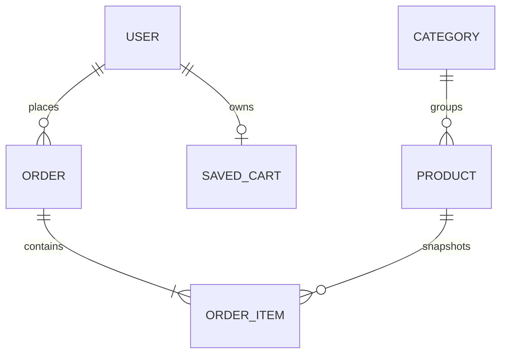
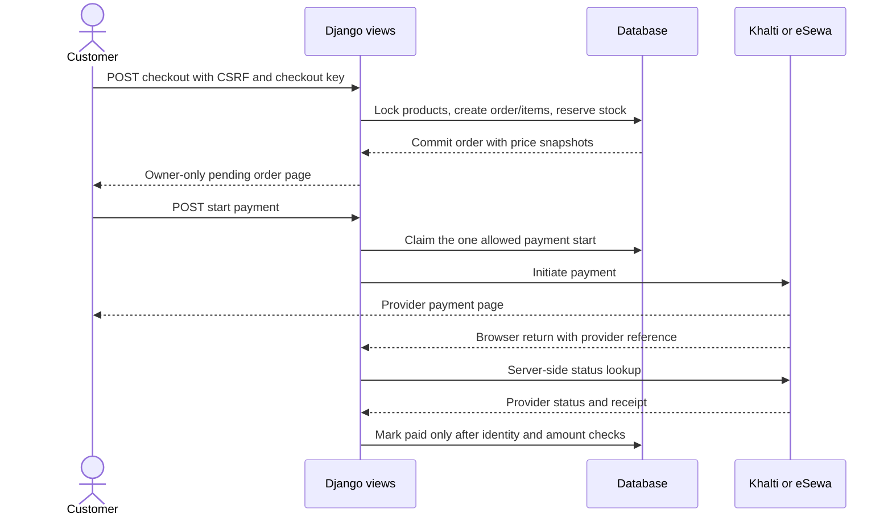

# Architecture and data model

## Data model

`SavedCart` belongs to an authenticated user. Guest cart lines live in the session, so a session cart is not a database table. Each `OrderItem` stores a unit-price snapshot. `Category` and products referenced by orders use protected deletion. The payment app has no payment-attempt table; each new order allows one claimed gateway attempt.

## Checkout and payment boundary

The browser return is a signal to check the provider. It is not evidence of payment by itself. The initiation ID stays in `payment_ref`; the final verified receipt is stored separately.

## Order lifecycle

```mermaid
stateDiagram-v2
    [*] --> Pending: checkout reserves stock
    Pending --> Starting: one gateway claim
    Starting --> Pending: provider reference recorded
    Starting --> Starting: uncertain initiation; manual review
    Pending --> Paid: matching server-verified success
    Pending --> Cancelled: customer cancels before initiation
    Pending --> Failed: verified terminal Khalti non-payment
    Pending --> Pending: timeout, pending, unknown, eSewa failure return
    Cancelled --> [*]: stock released once
    Failed --> [*]: stock released once
    Paid --> [*]: no generic cancellation or restock
```

An eSewa `NOT_FOUND`, non-complete, contradictory, or unknown response remains pending for manual review. This is conservative: stock can remain reserved until an operator reconciles the provider. A late payment after stock release needs a separate refund/reconciliation workflow.

## Concurrency and operational limits

The service uses a database transaction, deterministic product ordering, conditional stock decrement, and row locks where supported. SQLite's `select_for_update()` does not establish the same concurrent transaction guarantees as PostgreSQL. Run concurrency tests on the intended production database before relying on simultaneous checkout behavior.
